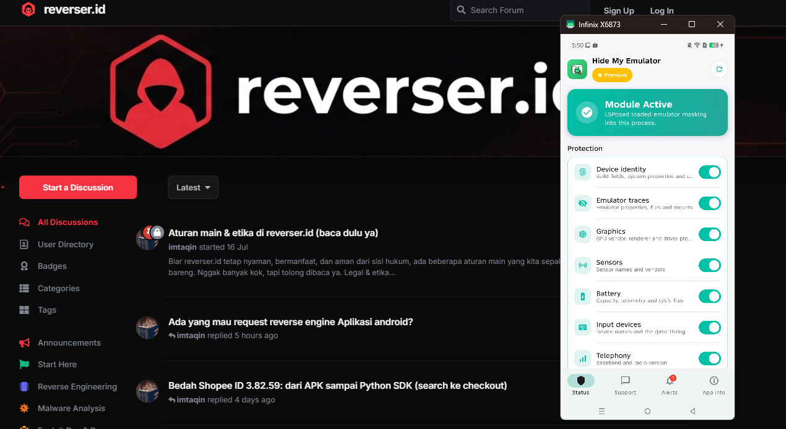
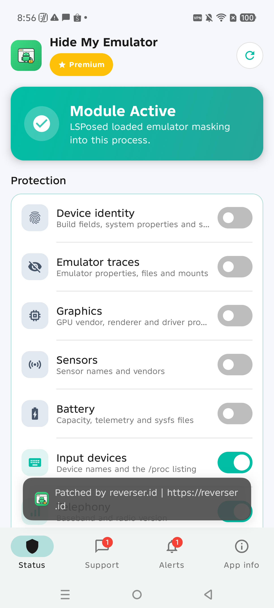

# HideMyEmulator → Premium patch

Reproducible smali patch for `net.wowsoftware.hidemyemulator` (1.3 and 1.4)
that forces lifetime-premium license state. `patch.py` auto-detects the version.
Verified on-device (Infinix, LSPosed): pill shows **Premium**, protections
toggle + Apply, no paywall sheet.



## v1.3 patch sites (local HME-License check, `o9/k` state)

| # | File | What |
|---|---|---|
| 1 | `smali/o9/a.smali` | `a(Lz9/h;J)Lo9/k` mapper always returns `new o9/h(null, null)` |
| 2 | `smali/o9/c.smali` | license-query exception fallback `o9/j` → `o9/h(null, null)` |
| 3 | `smali/ba/u.smali` | license combine (`:cond_5`) always emits premium `ba/s` |
| 4 | `smali/ba/v.smali` | initial license state `Lo9/i` → `o9/h(null, null)` |
| 5 | `.../core/ModuleStatus.smali` | `isModuleActive()` `false` → `true` |

The Xposed hook (`aa/f`, `w9/o`) never checks the license — only the UI gates
the toggles, so forcing the license state unlocks everything downstream.

## v1.4 patch sites (server-side licensing, `nb/s` state)
1.4 moved to account + `/api/subscription` licensing. 9 sites: `d9/b.r` mapper,
`ec/q` flow, `hc/r` unlock calc, `hc/s` combiner (a-flag, i-flag, license),
`hc/t` initial (a-flag, i-flag, license), plus `ModuleStatus`. Plus branding:
`app_info_not_activated` → Premium (EN+ID), launch Toast
"Patched by reverser.id | https://reverser.id". Verified on-device: Premium pill, protections toggle + Apply, survives restart.

Note: the `hc/s` combiner reads its license input from never-assigned fields,
so patching upstream flows alone never reaches the UI — the license must be
forced at the `hc/q` assembly point too.

## Usage

Requires: Apktool 3.0.3, Android build-tools (`zipalign`, `apksigner`), JDK.

```sh
python patch.py release-1.4.apk
# -> release-1.4-premium-signed.apk (ephemeral key, ready to install)
```

Cuma itu. Semua opsional: `--out`, `--keystore` (alias auto-detect),
`--apktool`, `--build-tools`, `--no-sign`, `--workdir`. JVM heap is capped
internally so it also builds on machines with a small pagefile.

Install:

```sh
adb install -r release-1.4-premium-signed.apk
```

Then in LSPosed Manager enable the module + scope, **reboot**, toggle
protections → Apply.

## Notes

- Output is signed with a debug/ephemeral key, not the dev key. Uninstall any
  official-signed copy first if signatures clash.
- Original APKs (`release-*.apk`) are inputs, not committed; place next to the script.
